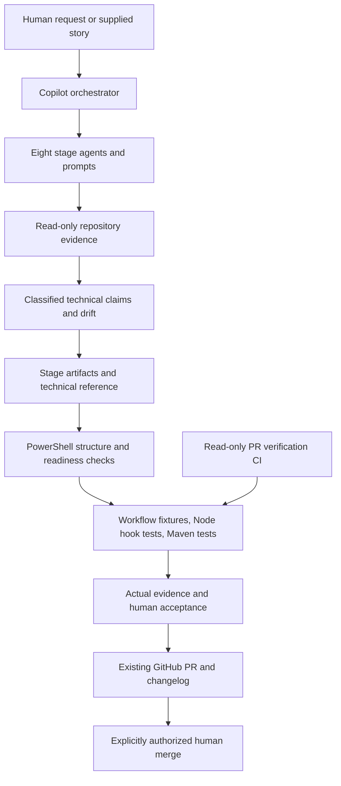

# Agentic SDLC — Automated Documentation Sync Architecture

**Project:** Java 11 Spring Boot Todo application  
**Use case:** GitHub Copilot Capstone — Automated Documentation Sync  
**Status:** Historical baseline approved; 2026-11-16 implementation amendment awaiting acceptance
**Requirements:** `docs/automated-documentation-sync/requirements.md`  
**Design review:** `docs/automated-documentation-sync/design-review.md`

## 1. Purpose and scope

This architecture defines the minimal, human-governed Copilot workflow for generating and synchronizing an accurate technical documentation view of the existing Java Spring Boot Todo application. The workflow does not implement or alter the Todo application itself. It is a documentation-use-case architecture only.

The system inspects repository evidence, records technical claims with source citations, flags stale or conflicting documentation, and proposes updates only within an approved allowlist. Human approval gates remain mandatory at each stage: before a documentation run, before any documentation change, before review/verification acceptance, and before PR submission.

## 2. Requirements traceability

The decisions below describe the historical architecture baseline. Historical approvals are preserved in workflow state; they do not approve the new executable-check amendment in Section 15.

| Proposed or recorded decision | Requirement effect |
|---|---|
| Human-initiated trigger | The workflow begins when a human invokes Copilot; the orchestrator then manages the subsequent SDLC stages. |
| Complete orchestrator | The architecture must coordinate eight stages, delegate to specialized work, maintain session state, and enforce approval gates. |
| Reference framework adaptation | The architecture uses the colleague reference as a structural pattern, not as a copy of business logic or unrelated project behavior. |
| Java Todo scope | All responsibilities and agent behavior remain scoped to the existing Java Todo application, not to password-reset logic or unrelated code paths. |
| Claim-level verification | Documentation claims must cite actual repository files and must be validated against source, tests, config, and Maven metadata. |
| Strict file safety | Only approved documentation files may be changed; app code, tests, and protected Todo docs remain untouched unless separately approved. |
| PR readiness gate | Review and verification artifacts are mandatory prerequisites before PR preparation. |
| README drift reporting | The root `README.md:24` describes the Add route as `/api/todo/add/{id}`, while `TaskControllerREST` maps base `/api/todo` and `POST /add`, yielding `POST /api/todo/add` with no path ID. See `docs/automated-documentation-sync/technical-reference.md:153-155` and `src/main/java/com/example/todoapp/controller/TaskControllerREST.java:18,35`. Report this as drift; do not silently correct the protected README. |

## 3. Existing repository components to preserve

The following repository artifacts are existing and must remain unchanged unless separately approved for a different task:

| Component | Existing responsibility and evidence |
|---|---|
| Web controller | `src/main/java/com/example/todoapp/controller/TaskController.java` handles web UI flows under `/todo`. |
| REST controller | `src/main/java/com/example/todoapp/controller/TaskControllerREST.java` defines REST routes under `/api/todo`. |
| Domain model | `src/main/java/com/example/todoapp/domain/Task.java` and `Priority.java` define the task model and enum values. |
| Persistence and migration | DAO, service, repository, and migration code under `src/main/java/com/example/todoapp/` define data access and migration behavior. |
| Runtime configuration | `src/main/resources/application.properties` and `data.sql` define app configuration and seed data. |
| UI assets | `src/main/resources/templates/` and `src/main/resources/static/` support the user-facing Todo UI. |
| Project metadata | `pom.xml` declares Java, Spring Boot, dependencies, and test configuration. |
| Existing tests | `src/test/java/com/example/todoapp/` contains controller, integration, persistence, migration, and template tests. |
| Existing requirements agent | `.github/agents/requirements-generator.agent.md` is for the Todo product Requirements stage and must remain unchanged. |
| Existing product docs | `docs/requirements.md`, `docs/architecture.md`, `docs/design-review.md`, and `docs/impl-plan.md` are task-priority project records and must remain protected. |

## 4. Proposed framework structure

The architecture reuses the overall structure of the colleague reference without copying its unrelated business logic. The architecture describes the intended minimal SDLC workflow. Current workflow state records that the orchestrator and documentation-sync agent, eight prompts, shared instructions, skills, session tracking, and technical reference exist. The optional `.github/hooks/session-save.js` also exists, but Node.js runtime validation remains pending; existence does not imply successful execution. Review and verification outputs remain governed by their separate human approval gates.

### 4.1 Mandatory components

These are required by the proposed architecture and remain subject to explicit human approval of this Architecture artifact.

1. Orchestrator agent
   - Coordinates all eight SDLC stages.
   - Maintains state between stages.
   - Delegates work to specialized agents and prompts.
   - Enforces approval gates.
   - Refuses to continue when a required artifact is missing or a human approval is pending.

2. Documentation-sync specialist agent
   - Inspects source, tests, config, dependencies, and existing documentation.
   - Generates or updates only approved documentation outputs.
   - Reports stale, conflicting, or missing evidence.
   - Produces cite-backed technical claims and labels uncertainty explicitly.

3. Stage prompts (eight stages)
   - One prompt per stage to drive consistent execution.
   - Keep the prompts straightforward and aligned to the assignment and the repository.
   - Use stage-specific outputs and checklists instead of ad hoc free-form prompting.

4. Shared instructions
   - Global guardrails for evidence-first behavior.
   - Rules against inventing facts.
   - File allowlist and modification scope.
   - Approval gating and review conditions.

5. Session state and artifact tracking
   - Store the current stage, approvals, outputs, and evidence references.
   - Provide traceability between requirements, architecture, design review, implementation, verification, and PR contents.

6. Review and verification artifacts
   - A dedicated implementation review record is required before verification can be accepted.
   - A dedicated verification record is required before PR preparation.
   - These records must be evidence-based and must not claim success without actual checks.

7. PR preparation artifact
   - Final PR contents must include Summary, Changes Made, Test Evidence, Known Limitations, and Reviewer Checklist.
   - PR preparation is blocked until review and verification records are complete.

### 4.2 Optional components

These are not assumed to be mandatory for this repository, but they may be used where they materially improve clarity without adding complexity:

- A dedicated review agent for implementation review.
- A dedicated verification agent or verification prompt.
- A reusable skill for evidence citation or drift detection.
- A repo-local session-save hook or lightweight session logger if the project benefits from it.
- Additional prompts for specific checklists only when needed to reduce ambiguity.

These are optional because the minimum viable design is an orchestrator plus a documentation-sync specialist and explicit human approval gates. The project should not add extra agents or automation without a clear need.

## 5. Framework component inventory

The following is the component structure the project should implement, based on the reference’s framework pattern while remaining minimal for this use case.

| Area | Proposed component | Responsibility | Mandatory? |
|---|---|---|---|
| Coordination | `.github/agents/orchestrator.agent.md` | Drive all eight stages, maintain state, delegate tasks, enforce approval gates. | Yes |
| Documentation generation | `.github/agents/documentation-sync.agent.md` | Inspect repo evidence, generate documentation, cite facts, flag drift. | Yes |
| Stage execution | `.github/prompts/01-requirements.prompt.md`, `.github/prompts/02-architecture.prompt.md`, `.github/prompts/03-design-review.prompt.md`, `.github/prompts/04-implementation-planning.prompt.md`, `.github/prompts/05-implementation.prompt.md`, `.github/prompts/06-implementation-review.prompt.md`, `.github/prompts/07-verification.prompt.md`, and `.github/prompts/08-pull-request.prompt.md` | Run each stage consistently with clear outputs. | Yes |
| Guardrails | `.github/instructions/*.md` or equivalent shared instructions | Enforce evidence-first behavior, scope control, no-fabrication rules, and approval gating. | Yes |
| Reusable logic | `.github/skills/*.md` or equivalent skill definitions | Reuse common tasks such as evidence extraction, drift detection, and review summaries. | Optional |
| Session state | `sessions/` or equivalent state store | Track current stage and outputs across workflow execution. | Yes if the orchestrator uses session continuity |
| Artifact storage | `generated/` or equivalent generated-output folder | Hold stage outputs and review artifacts. | Optional |
| Hooking | `.github/hooks/session-save.js` | Optional session audit/continuity mechanism. Its runtime validation is pending; it is not an automatic repository-change trigger. | Optional |
| PR artifact | `docs/automated-documentation-sync/pr.md` or equivalent PR scaffold | Prepare final ready-to-review PR content. | Yes |

The reference project demonstrates the framework’s structure; the Todo project will adapt it to a smaller, cleaner implementation that reflects this documentation-sync use case.

## 6. Orchestration behavior

The orchestrator is the central coordinator for the entire SDLC workflow. It must:

- Begin when a human invokes the workflow.
- Validate current repository state and selected scope.
- Record the stage being executed, the evidence used, and the approval status.
- Delegate each stage to the correct prompt or agent.
- Require explicit human approval before proceeding from one stage to the next when an approval gate exists.
- Preserve an audit trail of stage outputs.
- Block PR creation until the implementation review and verification records are complete and acceptable.

The orchestrator is mandatory because stage-to-stage coordination and traceability are required. Historical Design Review approval is recorded in workflow state; current amendments require separate acceptance.

## 6.1 Eight-stage flow and approval gates

| Stage | Inputs | Output | Required human approval gate |
|---|---|---|---|
| 1. Requirements | User-provided assignment information and repository context | `docs/automated-documentation-sync/requirements.md` | Approve the requirements baseline before Architecture. |
| 2. Architecture | Approved Requirements and repository evidence | `docs/automated-documentation-sync/architecture.md` | Approve the Architecture artifact before Design Review. |
| 3. Design Review | Approved Requirements and Architecture | `docs/automated-documentation-sync/design-review.md` | Approve design findings before Implementation Planning. |
| 4. Implementation Planning | Approved Requirements, Architecture, and Design Review | `docs/automated-documentation-sync/impl-plan.md` | Approve the plan and exact allowed changes before implementation. |
| 5. Implementation | Approved plan and authorized task dependencies | Capstone framework files under `.github/`, `sessions/`, and `docs/automated-documentation-sync/`, as listed in the plan and session state | Human approves the plan and exact files before implementation begins; separate Implementation-stage approval remains required before Verification. Implementation progress or task acceptance alone does not constitute that approval. |
| 6. Review | Implementation evidence and approved review instructions | `docs/automated-documentation-sync/implementation-review.md` | Human reviews the artifact and dispositions findings. The narrow ADS-PLAN-10 exception in `impl-plan.md:258` allows production/submission after ADS-PLAN-04 and ADS-PLAN-06 approval; accepting the artifact does not approve Implementation or authorize Verification. |
| 7. Verification | Reviewed implementation and dispositions, with Implementation-stage approval before progression | `docs/automated-documentation-sync/verification.md` | Human reviews and accepts actual verification outcomes before PR preparation. |
| 8. Pull Request | Accepted review and verification artifacts plus approved change scope | `docs/automated-documentation-sync/pr.md` or final PR description | Human approves final PR content before submission. |

This flow preserves the distinction between artifact/task acceptance and stage approval. The historical baseline stages were subsequently approved, with PR preparation distinct from submission. Consult `activeRevision` and `delivery` in workflow state for the current amendment and observed GitHub state rather than treating historical notes as current status.

## 7. Human approval gates

Human approval is required for all major phase transitions:

| Gate | Condition | Decision |
|---|---|---|
| Gate 1 | Before a documentation-sync run starts | Human confirms scope, repository target, and allowed files. |
| Gate 2 | After requirements approval | Human confirms the documentation scope and acceptance criteria. |
| Gate 3 | After architecture review | Human confirms the evidence model and file allowlist. |
| Gate 4 | After design review | Human decides whether the design can proceed to implementation planning. |
| Gate 5 | Before implementation | Human approves the plan and the exact file changes. |
| Gate 6 | Before verification acceptance | Human reviews review findings and verification evidence. |
| Gate 7 | Before PR submission | Human approves final review, verification outcome, and PR content. |

The workflow must never claim completion from agent output alone. Approval is a separate human action.

## 8. Trigger policy

Recorded policy: manual invocation only, consistent with Requirements and `.github/copilot-instructions.md`.

The workflow begins when a human explicitly invokes Copilot. The orchestrator then drives the stages. This avoids unsupported automation assumptions, keeps the initial implementation minimal, and preserves human control over documentation change scope and review outcomes.

Any automatic documentation-sync trigger on repository changes remains unresolved or out of scope unless a later human decision explicitly requires it. The optional session-save hook is an audit/continuity mechanism, not a repository-change trigger. Its presence does not claim that a CI or repository-event workflow exists.

## 9. Source-of-truth and evidence policy

Documentation claims must be based on repository evidence and must cite the relevant source file or files before being accepted.

### Evidence categories

| Claim type | Primary evidence |
|---|---|
| Route behavior | Controller mappings and relevant tests |
| Data model | Domain classes, migrations, repository code, and config |
| Dependencies and platform | `pom.xml` |
| Runtime config | `src/main/resources/application.properties` and related resources |
| UI behavior | Templates and controller model setup |
| Tests and coverage | Test classes and their actual assertions |
| Historical intent | Existing docs under `docs/` and approved requirements |

The documentation-sync workflow must prefer evidence over inference. If evidence is missing or conflicting, the record must state that the fact is uncertain, unsupported, or contradictory.

## 10. File allowlist and protected scope

The capstone project will only modify approved documentation within the capstone scope. The following files are protected by design and may not be edited without separate, explicit human approval:

- `docs/requirements.md`
- `docs/architecture.md`
- `docs/design-review.md`
- `docs/impl-plan.md`
- `src/main/java/**`
- `src/test/java/**`
- `pom.xml`
- `src/main/resources/**`
- `.github/agents/requirements-generator.agent.md`
- any files under `reference/colleague-capstone/`

The implementation plan must explicitly list all files that are allowed to change. The default is no change to application code or protected project docs. This protects the existing Todo feature implementation and the human-approved requirements baseline.

## 11. Verification model

Verification is claim-based and evidence-based. Before a documentation change can be accepted, the workflow must validate that:

- Each claim cites a concrete source file or test.
- Each route description matches the actual controller mapping.
- Dependency claims match `pom.xml`.
- Configuration claims match resource files and app config.
- Test claims match the assertions in the referenced test class.
- Conflicts are reported and not silently resolved.
- The known README route discrepancy is reported as documentation drift.

Verification is incomplete if a claim has no source, an unrun check, or a conflicting source. A verification record must clearly separate:

- Verified
- Not verified
- Contradicted by evidence
- Unresolved

This rule is mandatory before PR prep.

## 12. PR readiness conditions

PR preparation is allowed only if all conditions below are true:

1. Implementation review artifact exists and was reviewed.
2. Verification artifact exists and was reviewed.
3. No unresolved high-severity evidence or scope violations remain.
4. Allowlist changes are limited to approved capstone documentation only.
5. The final PR includes required sections: Summary, Changes Made, Test Evidence, Known Limitations, and Reviewer Checklist.
6. Human approval is recorded before the final PR is submitted.

The system must not infer PR readiness from an agent summary or an unreviewed set of generated files.

## 13. Risks and limits

| Risk | Architectural response |
|---|---|
| Stale documentation | Re-run evidence checks against the current repository state and report drift. |
| Missing evidence | Mark claims as unverified or unresolved. |
| Invented facts | Disallow any claim without direct repository evidence. |
| Conflicting repo sources | Record both sources and the conflict for human review. |
| Mis-scoped changes | Apply file allowlist enforcement and block edits outside the approved path set. |
| Avoidable complexity | Keep to the minimum required setup: orchestrator, documentation-sync agent, prompts, instructions, session state, and mandatory review/verification artifacts. |

## 14. Architecture approval status

**Approval status: Approved by explicit human decision.** `sessions/workflow-state.json` records the Architecture stage as approved for `docs/automated-documentation-sync/architecture.md`, with the human decision and approval timestamp recorded.

The following remain proposed architectural constraints for human review:

- The orchestrator remains central and mandatory.
- Human-initiated execution remains the trigger.
- The workflow stays documentation-only and does not change the Todo application or protected docs.
- All stage outputs remain traceable to repository evidence.
- Review and verification artifacts remain mandatory gates before PR preparation.

The historical approval does not approve the new amendment. The 2026-11-16 human request authorizes implementation work; current review/verification acceptance and merge remain separate decisions.

## 15. Executable completion architecture - 2026-11-16

| Component / technology | Responsibility and rationale |
|---|---|
| Copilot orchestrator and eight stage specialists | Human-facing SDLC execution using existing prompts, shared instructions, and skills. These instructions are not an OS-level security boundary. |
| `.github/scripts/workflow.ps1` / PowerShell | Read-only evidence/path checks, claim classification, stage approval checks, structural validation, and separate PR readiness. Reuses Windows tooling without adding a testing package. |
| `.github/tests/workflow.tests.ps1` | Isolated fixture-based workflow unit/integration regression cases, including missing/empty evidence and approval failures. |
| `.github/tests/session-save.test.js` / Node 22 built-in runner | Executes the real hook in isolated temporary repositories; rejects invalid events and checks metadata-only audit logging and state preservation. |
| `.github/workflows/documentation-sync.yml` | Read-only PR/manual verification on Windows, Java 11, and Node 22. Runs existing Maven tests plus workflow/document/hook checks; does not generate documentation or approve a stage. |
| `activeRevision` and `delivery` in workflow state | Separate current amendment acceptance from historical approvals and remote PR observations. |
| Git + GitHub PR | Authorized scoped commit/push and reuse of the branch's existing PR; review and merge remain human-controlled. |

Data flows from the supplied story and repository into cited claims, review, verification, and the PR. Missing/malformed inputs produce explicit errors; unsupported claims remain classified, not silently filled. Evidence paths must remain inside the repository, including existing link targets. The hook cannot grant approval. Structural verification may pass while readiness correctly fails because the exact amended artifacts await human acceptance.

The actual eighth prompt is `08-pull-request.prompt.md`; older references to `08-pr.prompt.md` are historical plan wording, not a second executable path.
