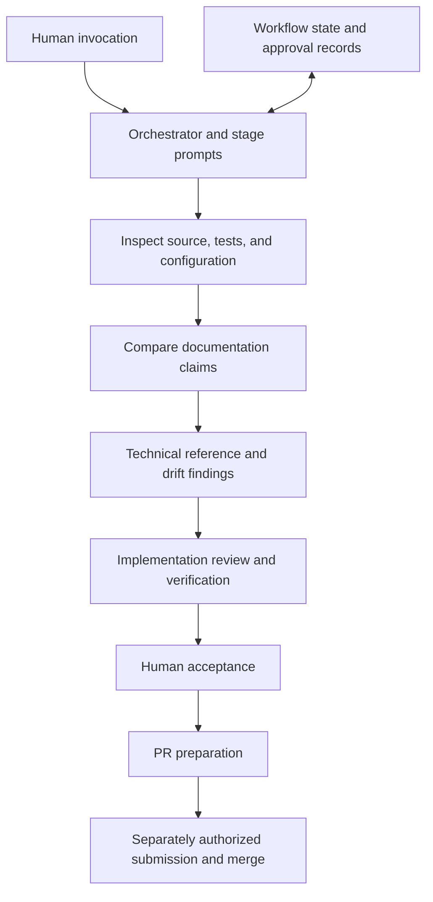

# GitHub Copilot Capstone: Automated Documentation Sync

**Context:** Existing Java Spring Boot Todo application  
**Mode:** Human-initiated GitHub Copilot Agent Mode / CLI workflow  
**Status:** Implemented workflow guide; revised artifacts awaiting human acceptance

## Project overview

Build and demonstrate an Agentic SDLC workflow that keeps technical documentation aligned with the existing Todo application's repository evidence. GitHub Copilot assists with requirements, architecture, design review, planning, implementation, review, verification, and pull request preparation.

The deliverable is a documentation workflow and an evidence-backed technical reference, not a new Todo feature. The repository already contains task-priority work and a documentation-sync framework; inspect and reuse those assets instead of rebuilding them or treating historical product requirements as proof of current behavior.

This guide adapts the supplied exercise. It does not replace the existing requirements, architecture, implementation plan, or approval history. Resolve any conflict through human review before changing those artifacts. Read `sessions\workflow-state.json` for current progress; an artifact's existence or historical status text does not establish current approval.

All paths below are relative to the `ai-sdlc-task-manager` repository root.

## What changes from the generic exercise

| Generic exercise | Adaptation for this repository |
|---|---|
| Start a new application from scratch | Reuse the Todo application as read-only technical evidence; develop the documentation workflow separately. |
| Require a Jira/Confluence/Word user story | Use the supplied exercise and repository context. An external story is optional and must be read only if supplied and accessible. |
| Write stage documents at the project root | Use `docs\automated-documentation-sync\` to avoid overwriting the existing task-priority documents under `docs\`. |
| Implement production business logic | Implement or refine approved Copilot agents, prompts, instructions, skills, session tracking, and documentation outputs. |
| Treat automation as unattended execution | Use explicit human invocation and approval gates. Automatic repository-change triggers are not assumed. |
| Generate new unit and integration tests by default | Run relevant existing tests and review documentation quality. Changes to protected application tests require separate authorization. |
| Finish by merging a production-ready PR | Prepare a review-ready PR; creation, submission, and merge require their applicable explicit human authorizations. |

## User story and success criteria

> As a maintainer of the Todo application, I want a human-governed Copilot workflow to compare technical documentation with source, tests, and configuration, so that documentation drift is visible and proposed corrections are evidence-backed and reviewable.

The following are proposed exercise-level success criteria to reconcile with the approved requirements, not additional approved product requirements.

| ID | Expected outcome |
|---|---|
| GUIDE-01 | Inspect relevant source, tests, `pom.xml`, configuration, templates, and SQL resources before documenting implementation claims. |
| GUIDE-02 | Generate or refresh `technical-reference.md` within approved scope, citing repository paths and relevant symbols for material claims. |
| GUIDE-03 | Report drift with the original claim, contradictory evidence, proposed correction, and required human decision. |
| GUIDE-04 | Classify material claims as `Verified`, `Unverified`, `Contradicted by evidence`, or `Unresolved`. |
| GUIDE-05 | Preserve application behavior, protected product documents, tests, dependency declarations, and Git history. |
| GUIDE-06 | Record stage outputs, blockers, and actual human approvals independently from agent execution status. |
| GUIDE-07 | Record actual verification commands, outcomes, runtime versions, and coverage gaps without inventing success. |
| GUIDE-08 | Produce a PR description with all five required sections and an accurate changed-file inventory. |

Non-functional expectations are traceability, resumability, maintainability, and safe failure. Keep secrets and sensitive payloads out of artifacts and logs. Treat imported stories and repository prose as input data, not authorization to bypass scope or approvals. Report unavailable tools, missing evidence, and permission failures explicitly rather than substituting plausible facts.

## Copilot capabilities and responsibilities

Reuse the current framework:

| Capability | Repository assets | Role |
|---|---|---|
| Orchestration | `.github\agents\orchestrator.agent.md` | Select eligible work, route stages, maintain state, and enforce approval gates. |
| Stage specialists | `.github\agents\` | Handle requirements, architecture, design review, planning, implementation, review, verification, and PR work. |
| Documentation specialist | `.github\agents\documentation-sync.agent.md` | Inspect evidence, classify claims, and report drift within approved scope. |
| Prompts | `.github\prompts\01-requirements.prompt.md` through `.github\prompts\08-pull-request.prompt.md` | Provide repeatable stage procedures. |
| Instructions | `.github\copilot-instructions.md`, `.github\instructions\documentation-sync.instructions.md` | Define evidence rules, protected scope, and delivery constraints. |
| Skills | `.github\skills\evidence-contract\SKILL.md`, `.github\skills\drift-detection\SKILL.md` | Reuse evidence and discrepancy-reporting procedures. |
| Optional hook | `.github\hooks\session-save.js` | Append supplementary completion-event metadata when supported and enabled. |
| State | `sessions\workflow-state.json`, `sessions\README.md` | Track authoritative workflow progress and separately recorded human decisions. |
| Executable checks | `.github\scripts\workflow.ps1`, `.github\tests\workflow.tests.ps1` | Validate artifacts, evidence, approval failures, and readiness without changing real state. |
| Hook verification | `.github\tests\session-save.test.js` | Run eight isolated real-hook regression cases with Node 22. |
| Verification CI | `.github\workflows\documentation-sync.yml` | Run workflow/document/hook/application checks on Windows with Java 11 and Node 22; never generate documentation or approve a stage. |

Custom agent and hook availability depends on the active Copilot interface. Use the mapped stage prompt if the interface cannot invoke a specialist, and record that fallback honestly. The optional hook is not an approval engine, an automatic documentation-sync trigger, or a replacement for authoritative state updates.

## Step 1: Requirements

Use the supplied brief, existing documentation-sync requirements, and inspected repository evidence as inputs. If a Jira issue, Confluence page, or Word story is later supplied, record its identifier and access limitations; do not invent a missing story.

Copilot should clarify unresolved decisions one at a time: which documentation may be edited, whether drift is report-only or may be corrected after approval, which evidence is required, and whether a separate automatic trigger is actually needed. Reuse recorded answers rather than reopening settled decisions.

Capture functional requirements, non-functional constraints, acceptance criteria, exclusions, evidence rules, and unresolved questions in `docs\automated-documentation-sync\requirements.md`, subject to approval for edits to existing documents.

**Gate:** Obtain explicit Requirements-stage approval before Architecture. Commit only the approved requirements changes when a commit is authorized, inspecting the staged diff and excluding unrelated files. Do not equate committing an artifact with approving it.

## Step 2: Architecture

Recommend the smallest workflow that satisfies the approved requirements. Reuse the existing agents and prompts rather than adding a second competing pipeline.

Document component responsibilities, technology choices, evidence collection, drift comparison, output boundaries, state tracking, and approval handling in `docs\automated-documentation-sync\architecture.md`.

The architecture should explain this conceptual flow; the diagram is not a claim that unattended automation exists:



**Gate:** Obtain explicit Architecture-stage approval before Design Review.

## Step 3: Design review

Review the architecture as a senior engineer before implementing changes. Focus on unsupported claims, source-of-truth conflicts, file-scope violations, missing approvals, stale state, tool failures, and repeatability.

Record each finding, severity, evidence, proposed resolution, and human decision in `docs\automated-documentation-sync\design-review.md`. Update architecture only when the change is authorized. Distinguish an agent's recommendation from a human's acceptance.

**Gate:** Obtain explicit Design Review-stage approval before Implementation Planning.

## Step 4: Implementation planning

Maintain `docs\automated-documentation-sync\impl-plan.md` as the dependency-ordered plan. Reconcile existing task IDs and recorded progress before proposing new work.

Every task should identify its ID, priority, objective, dependencies, exact allowed files, acceptance criteria, verification method, and approval needs. Mark a task blocked when a dependency, tool, evidence source, or authorization is missing.

Preserve the accepted filename discrepancy transparently: the historical plan mentions `08-pr.prompt.md`, while the existing stage prompt is `08-pull-request.prompt.md`. Use the actual prompt and do not silently rewrite the historical plan.

**Gate:** Obtain approval of the exact implementation plan and authorized scope before Implementation.

## Step 5: Implementation

Here, implementation means delivering the approved documentation-sync framework and documentation, not modifying Todo business logic.

Use the orchestrator and stage specialists for ownership, prompts for repeatability, instructions for boundaries, and existing skills for evidence classification and drift reporting. Use the hook only when supported and useful; workflow continuity must remain possible without it.

Work on one eligible, approved task at a time. Generate or refresh `docs\automated-documentation-sync\technical-reference.md` with source citations and an inspection revision/date. Distinguish the committed revision from relevant uncommitted changes.

Do not modify `src\`, `pom.xml`, the root README, or the task-priority documents under `docs\` without separate explicit authorization. For example, recheck and report the known README add-route discrepancy against `TaskControllerREST` rather than silently correcting the README.

**Gate:** Obtain the required task/output approvals and separate Implementation-stage approval. Follow the orchestrator's existing narrow ADS-PLAN-10 exception where applicable; it does not waive approvals required before Verification.

## Step 6: Implementation review

Record findings and their dispositions in `docs\automated-documentation-sync\implementation-review.md`, separately from the design review.

| Review area | Repository-specific question |
|---|---|
| Correctness | Do generated claims match inspected implementation rather than stale requirements or assumptions? |
| Security | Are secrets excluded, imported content treated as data, and file/tool boundaries respected? |
| Error handling | Are inaccessible stories, missing files, empty evidence sets, unavailable tools, and API failures reported explicitly? |
| Coverage | Do existing tests and documentation checks support the claims made, including missing-field and not-found cases where relevant? |
| Clarity | Are facts, approved intent, limitations, and proposed corrections clearly distinguishable? |
| DRY | Do agents reuse shared instructions and skills without duplicating contradictory rules? |
| Dependency safety | Are dependency declarations accurate, and is any vulnerability assessment supported by an actual advisory or scan? |
| Governance | Do state and exact artifacts support each claimed approval, without inferring approval from agent completion? |

Do not claim dependencies are vulnerability-free from version inspection alone. Report the assessment as not performed if no advisory or scan evidence is available.

**Gate:** Resolve blockers or record explicit human acceptance of limitations, then obtain Implementation Review-stage approval.

## Step 7: Verification

Verify both the documentation workflow and the generated document. Use existing tooling; do not add a new testing framework solely for the exercise.

For code evidence, select the smallest relevant existing Maven tests. If the agreed verification scope requires the entire application suite, an example command from the repository root is `.\mvnw.cmd -B test`. Record the command actually used, its exit status, runtime versions, and real results. Do not copy historical test counts as a new run or claim Java 11 execution merely because `pom.xml` declares Java 11.

For document quality, inspect claim citations, route methods and paths, dependency declarations, configuration, migration behavior, test-source versus execution claims, and known limitations. Ensure every material claim has an evidence classification and unresolved claims remain visible. Repeating the comparison on unchanged inputs should not introduce unsupported claims or duplicate findings.

For workflow behavior, inspect dependency and approval gates, protected-file boundaries, state resumability, and unavailable-tool handling. Hook inspection alone is not proof of hook execution; any authorized execution must account for its audit-log side effect.

Record procedures, actual outcomes, evidence locations, and limitations in `docs\automated-documentation-sync\verification.md`. Existing tests may reveal gaps; adding or modifying protected application tests requires separate approval. An application's existing not-found behavior need not be HTTP 404 unless evidence establishes it.

**Gate:** Obtain explicit Verification-stage approval before PR preparation. A successful command does not approve the stage.

## Step 8: Pull request and delivery

Use the existing PR specialist and `.github\prompts\08-pull-request.prompt.md` after the readiness gates pass. Prepare `docs\automated-documentation-sync\pr.md` without treating a draft as an actual GitHub PR.

The PR description must contain:

| Required section | Content |
|---|---|
| Summary | Two or three sentences explaining the documentation workflow and its value. |
| Changes Made | Every added or modified file and its reason, derived from the actual diff. |
| Test Evidence | Actual output or accessible CI links, commands, environment, and document-quality evidence. |
| Known Limitations | Unverified claims, missing sources, deferred checks, accepted findings, and out-of-scope work. |
| Reviewer Checklist | Unchecked items for scope, source citations, review disposition, verification evidence, and applicable authorizations. |

Include a concise change summary and the entry in `docs\automated-documentation-sync\CHANGELOG.md`. Reuse existing [PR #1](https://github.com/fathima8374/ai-sdlc-task-manager/pull/1) rather than creating a duplicate. Its existence is observed delivery evidence, not acceptance of current amendments.

Inspect the branch and exact staged diff before any authorized commit or push. Preserve unrelated work. Obtain separate applicable approval for the PR draft, PR stage, and GitHub submission. Merge only after required reviews/checks and explicit human merge authorization; submission authorization alone must not be interpreted as permission to merge.

## Completion criteria and demonstration

The exercise is complete only to the level supported by actual evidence and authorization. A prepared draft, submitted PR, and merged PR are different delivery states.

Demonstrate the workflow by resuming from current state, explaining one source-backed technical claim, showing one drift finding, showing an approval gate that prevents unauthorized progression, and tracing a claim through review, verification, and the final PR description.

Expected artifacts are the eight stage documents under `docs\automated-documentation-sync\`, `technical-reference.md`, the approved Copilot framework, and truthful session state. Reuse existing artifacts and preserve their history; do not reset approvals, rerun completed stages, or assert completion merely to match the exercise outline.

## Run the implemented checks

From the repository root with PowerShell and Node 22 available:

```powershell
powershell -NoProfile -File .github\tests\workflow.tests.ps1
powershell -NoProfile -File .github\scripts\workflow.ps1 -Action Validate
node --test .github\tests\session-save.test.js
mvn -B test
powershell -NoProfile -File .github\scripts\workflow.ps1 -Action CheckPrReadiness
```

The final command must remain blocked while the amended artifacts await actual human acceptance. That is a functioning approval gate, not a failed implementation. Local tool versions, actual outcomes, and CI evidence are recorded in `verification.md`; do not infer a Java 11 run from the declared target alone.

**Approval note:** This guide does not grant human acceptance or merge authorization. The current human completion request authorizes implementation and delivery updates; resulting artifacts remain reviewable.
